= Eclipse JNoSQL REST with GlassFish and MongoDB
:toc:
:toclevels: 1

Eclipse JNoSQL REST generates Jakarta REST APIs from Jakarta Data repositories.
This example runs on GlassFish with MongoDB, demonstrating automatic DTO mapping, pagination, dynamic queries, and API documentation.

*One Jakarta Data repository. Generated REST API. No handwritten resource classes.*

== What this example demonstrates

The intended quickstart is just:

[source,bash]
----
docker compose up -d
./mvnw clean package embedded-glassfish:run
----

IMPORTANT: The REST extension is currently available only as `2.0.0-SNAPSHOT`, not a Maven Central release.
The build requires access to https://central.sonatype.com/repository/maven-snapshots.
In the implementation environment that host could not resolve: the build stopped before annotation processing.
GlassFish startup and MongoDB connectivity were verified independently, but WAR deployment, generated sources, DTO mapping, and HTTP operations remain *unverified*.
This is not yet an end-to-end validated quickstart.

The example declares creation, lookup, deletion, paginated listing, and dynamic restriction search.
REST resources, DTO records, and CDI MapStruct mappers are generated during normal Maven compilation.
API documentation is an optional generator integration; MicroProfile OpenAPI is not enabled here (see <<openapi>>).

== Architecture

The editable Mermaid source is link:docs/architecture.mmd[architecture.mmd].
The checked-in SVG lets GitHub display the diagram in AsciiDoc without a diagram build step.
MapStruct and optional OpenAPI annotations participate in generation; they are not separate services.
At runtime, the generated resource delegates to GlassFish's Eclipse JNoSQL repository integration.

== Prerequisites

* Java 21 (`java -version`; ensure `JAVA_HOME` points to Java 21).
* Docker with Docker Compose.
* Internet access to Maven Central and the Sonatype snapshot repository.

The official wrapper supplies Maven 3.9.16, required by embedded plugin 8.1.
No GlassFish installation, `asadmin`, IDE setup, or deployment scripts are needed.
GlassFish 9.0.0-M4 is an early-access release, not a final Jakarta EE 12 implementation.
The POM uses the individual API versions actually bundled by M4, including Jakarta Data and NoSQL 1.1.0-M4.
It does not assume a final Jakarta EE 12 API bundle is available.

== Start MongoDB

[source,bash]
----
docker compose up -d
----

Compose runs MongoDB 8.0.16 with port 27017 bound to localhost and a persistent volume.
MongoDB creates `product_catalog` and its collection on the first insert; no manual database creation is necessary.
Configuration lives in `src/main/resources/META-INF/microprofile-config.properties`:

[source,properties]
----
jnosql.document.database=product_catalog
jnosql.mongodb.url=mongodb://localhost:27017
----

Override these defaults with `JNOSQL_DOCUMENT_DATABASE` and `JNOSQL_MONGODB_URL`.
GlassFish supplies MicroProfile Config 3.1.3; the WAR does not package another Config implementation.
Run `docker compose down` to stop MongoDB (`down -v` also deletes the catalog).

== Run the application

[source,bash]
----
./mvnw clean package embedded-glassfish:run
----

The official `org.glassfish.embedded:embedded-glassfish-maven-plugin:8.1` downloads and starts *GlassFish 9.0.0-M4* in a forked JVM and deploys the standard WAR automatically after `package`.
The compiler explicitly enables Eclipse JNoSQL REST and MapStruct annotation processors in the same compilation.
The server is a plugin dependency, never part of `WEB-INF/lib`.
The MongoDB adapter excludes JNoSQL mapping and communication implementations already supplied by GlassFish.

Port 8080, context root `/`, and application path `/api` configure the API at:

----
http://localhost:8080/api/products
----

This is the configured URL, not a verified deployed endpoint while snapshot resolution is blocked.
In interactive mode, enter `X` to undeploy and stop; Enter redeploys.
This demonstration has no authentication or authorization: do not expose it as a production service.

== Explore the REST endpoints

[cols="1,3,2",options="header"]
|===
|Method |Path |Purpose
|POST |`/api/products` |Create
|GET |`/api/products` |Paginated list
|GET |`/api/products/{id}` |Find by ID
|DELETE |`/api/products/{id}` |Delete by ID
|QUERY |`/api/products/search` |Dynamic restrictions
|===

Create, then copy the returned `id` into the lookup URL:

[source,bash]
----
curl -i http://localhost:8080/api/products \
  -H 'Content-Type: application/json' \
  -d '{"name":"Keyboard","description":"Mechanical","category":"peripherals",
       "price":89.90,"manufacturer":{"name":"Keyco","country":"Brazil"},
       "supplier":{"name":"Acme","accountManager":"Jane","contractReference":"C-1001"},
       "supplierCost":55.00,"internalNotes":"Negotiate volume discount"}'

curl http://localhost:8080/api/products/REPLACE_WITH_RETURNED_ID
curl 'http://localhost:8080/api/products?size=10&offset=0&includeTotal=true'
curl -X DELETE http://localhost:8080/api/products/REPLACE_WITH_RETURNED_ID
----

Pagination uses `size` (default 20, range 1–100), `offset` (zero-based page offset, default 0), and `includeTotal` (default false).
The generated page response contains `content`, `offset`, `size`, `hasNext`, and `hasPrevious`; totals are included when requested.

Dynamic restrictions keep the framework's HTTP `QUERY` method:

[source,bash]
----
curl -X QUERY http://localhost:8080/api/products/search \
  -H 'Content-Type: application/json' \
  -d '{"category":{"eq":"peripherals"},"price":{"between":[50,100]}}'
----

The generated search request combines filters with AND.
No GET or POST substitute is introduced.
The integration test explicitly exercises QUERY through GlassFish/Jersey; runtime support remains unverified until that test runs.
Some HTTP clients and proxies may reject this method.

== Understand the repository annotations

See link:src/main/java/com/github/otaviojava/rest/ProductRepository.java[ProductRepository].
It deliberately does not extend `BasicRepository`.

* `@Repository`: Jakarta Data's declarative persistence contract.
* `@RestRepository(path = "/products")`: enables the Eclipse JNoSQL REST extension.
* `@RestDTO`: determines public response and writable request fields.
* `@Insert`, `@Find`, `@Delete`: declare the repository operations.
* `@Path("")`, `@Path("{id}")`, `@Path("search")`: explicitly select routes.
* `@OrderBy("id")` and `PageRequest`: stable paginated listing.
* `Restriction<Product>`: generates a typed search body and HTTP QUERY.

Generation is an Eclipse JNoSQL extension, not a feature mandated by Jakarta Data.

== DTO generation and data exposure

* `ProductCreateRequest` excludes `id`, but retains supplier, supplier cost, and internal notes.
* `ProductDTO` excludes `supplier`, `supplierCost`, and `internalNotes`.
* Generated nested `ManufacturerDTO` and `SupplierDTO` map to immutable NoSQL `GROUPING` records.
* MapStruct creates `ProductDTOMapperImpl`; no DTO or mapping implementation is handwritten.
* The adapter's `ObjectIdConverter` maps MongoDB-generated ObjectIds to Java String IDs, including lookup and delete criteria.

Inspect generated sources under `target/generated-sources/annotations` after a successful build.
Response exclusions do not remove persisted fields or replace access control.

[[openapi]]
== OpenAPI availability

GlassFish M4 bundles MicroProfile Config, Health, JWT, and REST Client, but *not MicroProfile OpenAPI*.
SmallRye OpenAPI core/JAX-RS libraries scan annotations; they do not automatically publish an `/openapi` endpoint on GlassFish.
No compatible drop-in runtime integration was verified, so this sample adds neither a competing server implementation nor handwritten OpenAPI YAML.
REST generation does not depend on OpenAPI.

When a compatible implementation is available, the REST processor can generate OpenAPI annotations for DTO schemas, successful responses, and typed pagination parameters.
OpenAPI 3.1 cannot natively represent an HTTP QUERY operation; do not expect five native operations in a 3.1 document or assume a UI can execute QUERY.

== Testing

[source,bash]
----
# Generated resource and mapper checks; no database required
./mvnw clean package

# Real deployment and MongoDB tests; stop any application already using port 8080
docker compose up -d --wait
./mvnw -Pit clean verify
----

`GeneratedApiTest` references generated classes directly and checks the five HTTP operations, nested record mappings, and exact request/response field sets.
`ProductCatalogIT` uses the same embedded plugin to start and deploy the WAR, then checks MongoDB ping, POST/GET/DELETE, pagination, HTTP QUERY, response exclusions, and actual stored nested documents.
It cleans up only its uniquely categorized products.
These tests use Compose's MongoDB rather than adding another container-management framework.
Failsafe reports live in `target/failsafe-reports`; unit reports in `target/surefire-reports`.

Validation performed: Java 21 wrapper execution, Compose configuration/startup, MongoDB ping, and embedded GlassFish M4 startup passed.
`clean package`, the targeted unit test, the two-command application run, and integration verification stop at unresolved `jnosql-rest-api:2.0.0-SNAPSHOT`.
Consequently no generated-source, deployment, REST, pagination, nested mapping, or QUERY success is claimed.

References: https://github.com/eclipse-ee4j/glassfish/releases/tag/9.0.0-M4[GlassFish M4],
https://github.com/eclipse-ee4j/glassfish-maven-embedded-plugin[official embedded plugin],
https://github.com/eclipse-jnosql/jnosql-extensions/tree/main/jnosql-rest[JNoSQL REST],
https://github.com/otaviojava/jnosql-rest-openliberty-2026[functional reference].
